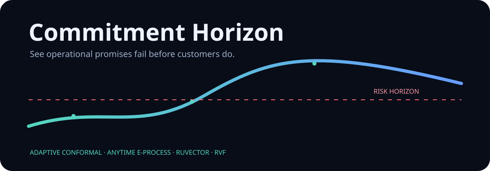
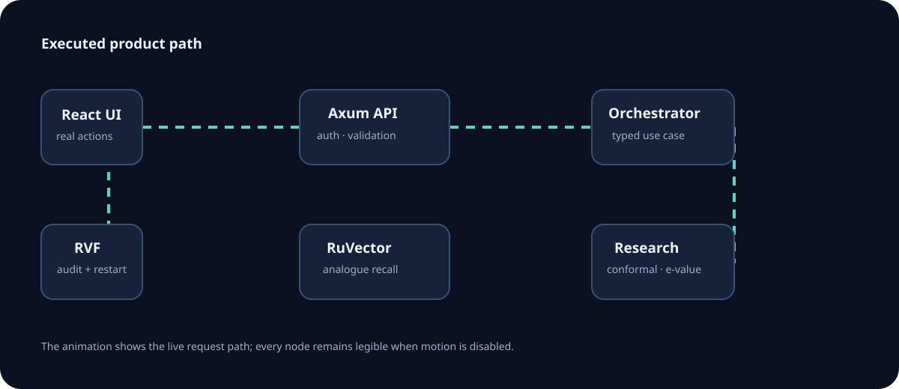
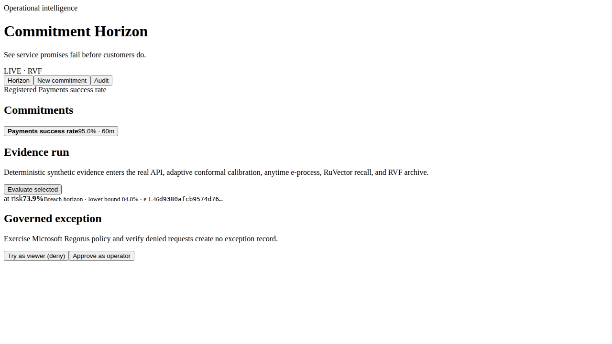
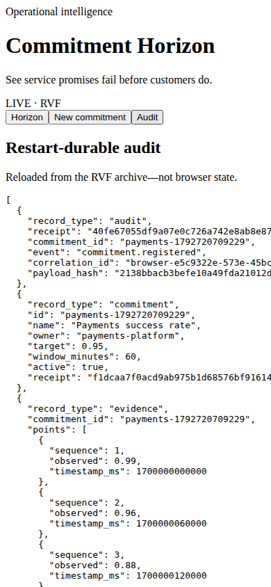

<p align="center"></p>

# Commitment Horizon

Commitment Horizon is an operational-commitment control plane: teams register measurable service promises, feed observed evidence, see an adaptive breach horizon with real analogue recall, govern temporary exceptions, and recover an append-only audit after refresh or restart.

It composes **RuVector Core 2.4.0** for analogue intelligence, **RVF Runtime 0.3.2** as the only prototype persistence layer, and **Microsoft Regorus 0.13.0** for executed exception policy. Adaptive conformal calibration and an anytime-valid e-process change the decision path; they are not citations around a threshold.

## Run the product

Prerequisites: Rust 1.99, Node 22, npm, and Chromium dependencies.

```bash
./scripts/bootstrap.sh
./scripts/start-prototype.sh
```

Open `http://127.0.0.1:4173`. Stop with `./scripts/stop-prototype.sh`; reset only the synthetic namespace with `rm -rf data/prototype`. The one-command verification is `./scripts/verify-prototype.sh`.

## Product journeys

1. Register a commitment and evaluate deterministic synthetic evidence. The browser calls the authenticated Axum API, all statistical/RuVector crates run, RVF appends the evidence and evaluation, and the UI renders the measured breach horizon.
2. Request an exception as a viewer. Regorus returns 403 and no exception is appended; retry as operator to obtain a durable receipt.
3. Open Audit, refresh or restart, and retrieve the same records from RVF.

<p align="center"></p>

## Workspace map

The 24 Rust crates form six real bands: contracts (`ch-errors`, `ch-types`, `ch-config`), domain (`ch-commitment`, `ch-evidence`, `ch-calibration`, `ch-eprocess`, `ch-forecast`, `ch-risk`), intelligence (`ch-embedding`, `ch-ruvector`, `ch-recall`), governance (`ch-regorus`, `ch-policy`, `ch-auth`, `ch-middleware`), durability/orchestration (`ch-audit`, `ch-rvf`, `ch-repository`, `ch-orchestrator`), and delivery/evidence (`ch-api`, `ch-seed`, `ch-evaluation`, `ch-cli`). [Architecture](docs/architecture.md) records each caller edge and acceptance condition.

## Composition and evidence

| Ingredient | Executed boundary | Product effect | Ablation |
|---|---|---|---|
| RuVector Core 2.4.0 | `VectorDB::insert/search` in `ch-ruvector` | Similar historical commitments appear with each evaluation | No analogue context |
| RVF Runtime 0.3.2 | `RvfStore::ingest_batch/open_readonly` in `ch-rvf` | Refresh/restart audit survives | No durable receipt retrieval |
| Microsoft Regorus 0.13.0 | `Engine::eval_rule` in `ch-regorus` | Exceptions are policy decisions, not UI guesses | Ungoverned or hard-coded decisions |
| Adaptive conformal + e-process | `ch-calibration` + `ch-eprocess` | Uncertainty and accumulating shortfall affect risk | Point forecast only |

Measured on the governed executor with deterministic synthetic evidence:

| Verification | Observed result |
|---|---|
| Live API benchmark | 50/50 evaluations; 69.878 ms mean |
| Combined decision utility | 0.8783 |
| Without calibration | 0.7766 |
| Without e-process | 0.8405 |
| Ruvnet-only analogue coverage | 0.2500; no calibrated breach decision |
| Enterprise-only point forecast | 0.7389 |





Raw commands, exit codes, versions, hashes, screenshots and browser traces are bound in `evidence/prototype/manifest.json` after verification. See [prototype acceptance](docs/prototype-acceptance.md), [integration matrix](docs/integration-matrix.md), [research](docs/research.md), [ADRs](docs/adrs/README.md), and [DDD index](docs/ddd/README.md).

## Maturity and limitations

This is a bounded high-fidelity prototype, not a production SLO platform. Authentication is an explicit local bearer-token adapter; replace it with IAM/OIDC. Local RVF persistence proves the product boundary but Cloud Run needs an authorized durable RVF service because its filesystem is ephemeral. Seeded values are synthetic. Forecasts are decision support and need calibration against a real environment. No cloud deployment or spend is claimed.

Licensed MIT OR Apache-2.0. Upstream licenses and exact pins are in [research](docs/research.md).
